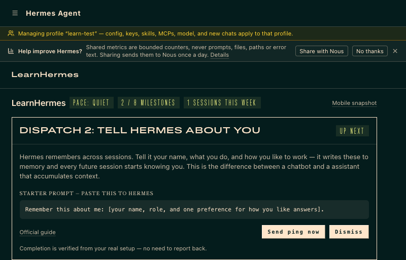

# LearnHermes

<p align="center"></p>

> **Beta — v0.1.3-beta.** Verified on macOS: 87 behaviour tests, `hermes plugins validate` + `doctor`, and real-CLI runs on a scratch profile (no stray processes, no ticks from short-lived commands). Earlier betas were also checked live for the wizard, milestone verification, dashboard and delivery. Windows is not yet tested. **Beta testers wanted** — see the pinned issue.

A companion for the Hermes journey. LearnHermes watches how you actually use
[Hermes Agent](https://github.com/NousResearch/hermes-agent), verifies your
progress from real artifacts, and sends **dispatches** — short, timed lessons
that meet you where you are. Brand-new users first; fast-moving users get a
fast-moving guide.

> "I seem to spend more time configuring and fixing my Hermes setup than I do
> getting work done with it. Surely, user error, but how do I learn?"
> — the tweet that started this project

Every guide that exists today is static content you go to. LearnHermes comes
to you, and it knows your setup.

## How it works

- **Observer** — deterministic reads of local state: sessions, cron jobs,
  agent-written skills, memory files, profiles, tool usage, API errors.
  No LLM involved in watching.
- **Learner model** — evidence-based progress. A milestone counts only when
  the artifact exists. You never report back; the observer verifies.
- **Timing engine** — one dispatch at a time, delivered only at natural
  pauses (no active session, idle ≥ 15 min), inside your send window, under
  your daily cap, spaced by your pace.
- **Dispatches** — bundled lessons grounded in the official docs: why it
  matters, a starter prompt to paste, the guide link. The ping is short;
  the dashboard carries the full lesson.

## Install

```bash
hermes plugins install eddwithers/learnhermes --ref b1e05aafdb765a12072bf4307a8fe5752f66b892 --no-enable
hermes plugins enable learnhermes
```

Or from source:

```bash
git clone https://github.com/eddwithers/learnhermes ~/.hermes/plugins/learnhermes
hermes plugins enable learnhermes
```

Once catalogued: `hermes plugins install learnhermes`.



## Starting the journey

Just chat. On your first conversation after install, Hermes offers to start
the journey and asks where dispatches should go. Answer in chat — Hermes
configures the channel and sends a first test dispatch. That's the whole
wizard.

Prefer manual control?

- `/dispatches` — journey status (`send`, `dismiss`, `scan` subcommands)
- Dashboard tab **LearnHermes** (`/learnhermes`) — journey map, current
  dispatch, settings
- Mobile snapshot — `/api/plugins/learnhermes/snapshot`, a self-contained
  HTML page (also linked from the dashboard)

## Settings

| Setting | Meaning | Default |
|---|---|---|
| `channel` | Any `hermes send` target: `telegram`, `discord:#chan`, `push`, `email`… | unset — pick one to start |
| `enabled` | Pause/resume dispatches | `true` |
| `send_start` / `send_end` | Hour window when dispatches may arrive; may wrap midnight | 9 → 20 |
| `max_per_day` | Daily dispatch cap | 2 |
| `dashboard_url` | URL used in ping links — set a phone-reachable address if you read pings on your phone | `http://127.0.0.1:9119/learnhermes` |

Set them in chat (the `learnhermes_journey` tool), on the dashboard, or via
`/dispatches`.

**Named profiles:** on a multiplexed gateway, dashboard and snapshot links
are automatically scoped with `?profile=<name>` so they open the right
profile's journey from your phone.

**Email:** LearnHermes never owns a sending address. If you choose email, it
rides your existing Hermes email route (your SMTP, your From). No route
configured? The plugin tells you, and setting one up can itself become a
dispatch. Email is one-way — replies are never parsed.

## Privacy & safety

- Observation is **local-only**. No telemetry, no network calls except the
  delivery you configure.
- **Prompt caching is untouched**: the one-time welcome is appended to the
  user message at API time, never the system prompt; nothing is persisted
  into transcripts.
- No core overrides, no tool interception. One tool, five observer hooks.
- Milestones are verified from artifacts — the plugin never trusts claims.
- Delivery always records to a local outbox (`plugin-data/learnhermes/`),
  so you can audit every ping.

## Development

```bash
hermes plugins validate .          # catalog CI checks
hermes plugins doctor . --ci       # real discovery + register(ctx)
# from a Hermes checkout:
scripts/run_tests.sh /absolute/path/to/learnhermes/tests -q
```

87 deterministic behaviour tests: milestone evidence, timing rules, send
window wraparound, settings migration, state recovery (bad JSON, wrong
shape, invalid UTF-8), delivery outbox + infra-noise filtering, channel
validation on both write paths (tool + dashboard), unconnected-channel
blocker surfacing (tick, status, `/dispatches`, snapshot), platform listing
via `hermes send --list --json` (a failed or never-run listing is
"unknown", never "none connected"), real send errors via `--json`,
timing-loop lifecycle (arms at register without a running loop — both
isolation modes' entry paths, exercised with a stub plugin context rather
than a real host — first tick waits a full interval, no executor thread
parked between ticks, profile scope kept on the fallback thread, race-free
arming, stops on unload), child processes
(a marked child never arms; an unmarked short-lived process exits promptly
and never ticks — both in a real separate Python process, not the real
`hermes` CLI), at-most-once delivery when a process dies mid-send or a
send times out, cross-process tick serialisation, snapshot escaping,
profile-scoped links, the conversational tool (blocker-surfacing status,
scoped dashboard link, send-now error mapping), one-time welcome and its
automation gates.

## Roadmap

- Struggle-signal reordering (errors jump the relevant lesson up the queue)
- LLM-personalised framing via host-owned `ctx.llm` (facts stay bundled)
- Snapshot publishing through [artifact-relay](https://github.com/eloktev/hermes-artifact-relay) for phone-reachable links without exposing the dashboard
- Rich opt-in email digest

## License

MIT — see [LICENSE](LICENSE).
